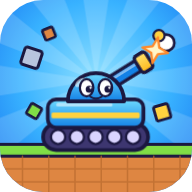

# Rubble Rumble: Tank Siege

A cartoon 3D artillery tank duel in fully destructible voxel arenas. Aim, fire, topple towers and crush your enemy.

**Play:** https://teodorkrustev0-arch.github.io/rubble-rumble/

- Turn-based and Rapid modes, 6 arenas, 15 ammo types
- 8 tanks to unlock with Medals, a Mk I–V garage
- Installable as an app (PWA) and playable offline

Everything is in one `index.html`. `sw.js` and `manifest.webmanifest` make the game installable and let it work offline.
